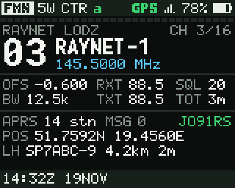

# RT3S — instrukcja obsługi funkcji z forka

Dotyczy obrazu `OpenGD77_MDUV380.bin` z gałęzi `feature/sk-shortcuts-waterfall`.
Te funkcje **nie były jeszcze testowane na radiu**.

Oznaczenia klawiszy:

* **SK1**: dolny boczny przycisk.
* **SK2**: górny boczny przycisk.
* **Gałka**: pokrętło kanałów.
* **GREEN / RED**: zielony i czerwony klawisz menu.
* **„SK1 + 0”**: trzymaj SK1 i krótko naciśnij 0.

RT3S nie ma pomarańczowego przycisku. Firmware zastępuje go kombinacją **SK1 + GREEN**.

---

## Ekran główny EMCOM (domyślny)

Ekran kanału i VFO jest wzorowany na radiach profesjonalnych i wojskowych: wszystko ma stałe miejsce, numer kanału jest najważniejszy, stan radia widać kolorem **i** napisem. Powrót do starego wyglądu: *Opcje → Wyświetlacz → Screen: Classic*.



Od góry:
* **Pasek stanu:** pole stanu (tryb FM/FMN/DMR w spoczynku, `RX` zielone, `TX` czerwone razem z całym paskiem, `SCAN` bursztynowe), moc, ton CTCSS/DCS albo szczelina TS, `a` (beacon APRS), `GPS` (zielony = fix), głośność (4 słupki, `x` = wyciszone), bateria.
* **S-metr:** 32 segmenty, od S9 w górę bursztynowe; przy nadawaniu poziom mikrofonu na czerwono.
* **Kanał:** strefa i `CH 3/16`, duży numer, nazwa, częstotliwość (`TX` przy nadawaniu, `REV` odwrócony przemiennik, `TA` talkaround). W VFO duża częstotliwość.
* **Panel:** w FM offset, ton RX/TX, blokada szumów, szerokość kanału, TOT; w DMR TG, CC, TS i kontakt. Przy odbiorze FM poziom w dBm i S, przy rozmowie DMR znak, TG i reszta aliasu, przy nadawaniu duży licznik czasu.
* **Wiersze EMCOM:** liczba stacji APRS, nieprzeczytane wiadomości (`MSG 1` na niebiesko), lokator, pozycja (GPS albo stała lokalizacja z ustawień), ostatnio słyszana stacja (DMR albo ostatnia stacja APRS z odległością).
* **Stopka:** czas UTC i data, blokada klawiatury/PTT, skanowanie, SOS.

W nocy (przełączanie dzień/noc albo auto-noc) ekran jest tylko czerwony, żeby nie psuć widzenia nocnego. W trybach specjalnych VFO (sweep, dual watch, wpisywanie częstotliwości) i w podglądzie szczegółów kanału zostaje stary ekran.

### SOS: `SK1 + 9` dwa razy

Dwa naciśnięcia `SK1 + 9` w ciągu 3 s (albo akcja quickkey *SOS*) włączają alarm: migający pasek `EMERGENCY SOS` i beacony APRS z pozycją, symbolem alarmu i tekstem `EMERGENCY SOS` (3 razy co minutę, potem co 2 minuty). Nadawanie idzie przez konfigurację APRS kanału (na jej częstotliwość QSY, jeśli jest ustawiona); bez niej radio pokaże `SOS: no APRS config`. Wyłączenie: znowu dwa razy `SK1 + 9`.

### Zrzuty ekranu

Z radiem włączonym i podłączonym przez USB: `python3 MDUV380_firmware/tools/opengd77_screenshot.py -o ekran.png` (wymaga `pip install pyserial`).

---

## 1. Szybkie klawisze (Quickkeys)

### Przypisanie akcji do klawisza

1. Na ekranie kanału lub VFO naciśnij **GREEN**, żeby otworzyć menu.
2. Wejdź w **Opcje**, a potem w **Szybkie klawisze** (ostatnia pozycja na liście).
3. Widzisz sloty `0`–`9` i to, co jest do nich przypisane. `Brak` oznacza pusty slot.
4. Wybierz slot strzałkami **▲/▼** albo naciskając cyfrę slotu.
5. Kręć **gałką**, żeby przełączać przypisanie. Do wyboru są:
   * Brak;
   * APRS beacon;
   * APRS on/off;
   * Day/Night;
   * Band scope;
   * Scope: to peak;
   * menu: RSSI, Last heard, Zones, Contacts, Radio info, Satellite, GPS, APRS.

   Zmieniony slot jest oznaczony gwiazdką `*`.
6. Naciśnij **GREEN**, żeby zapisać i wyjść. **RED** wychodzi bez zapisywania.

### Uruchomienie akcji

Na ekranie kanału lub VFO: **SK2 + cyfra slotu**. Na przykład: trzymaj SK2 i krótko naciśnij `5`.

* Akcja nie może się wykonać, np. „Scope: to peak” poza waterfallem → radio da krótki sygnał błędu (NACK).
* Kasowanie slotu: **SK2 + długie naciśnięcie cyfry**. Możesz też ustawić „Brak” w menu.

### Co robi każda akcja

| Akcja | Działanie | Odpowiednik bez Quickkeys |
|---|---|---|
| APRS beacon | Wysyła beacon APRS teraz. | `SK1 + 2` |
| APRS on/off | Włącza i wyłącza beaconing APRS. | `SK1 + 1` |
| Day/Night | Przełącza motyw dzienny i nocny. | `SK1 + RED` |
| Band scope | Uruchamia analizator pasma / waterfall. Z ekranu kanału przełącza na VFO i zatrzymuje skanowanie. | długie `#` w VFO |
| Scope: to peak | Stroi VFO na najsilniejszy sygnał. Działa tylko, gdy waterfall jest aktywny. | `SK1 + 0` w waterfallu |
| (menu) | Otwiera wskazane menu, np. RSSI albo GPS. | — |

Slot z akcją nie zostanie przypadkiem nadpisany gestem „SK2 + cyfra w menu”. Żeby nagrać w nim coś innego, najpierw go skasuj.

---

## 2. Waterfall / analizator pasma (VFO)

1. Przejdź w tryb VFO.
2. **Długie `#`**: start analizatora. Środek pasma to częstotliwość VFO.
3. **`*`**: przełącza widok między waterfallem a słupkami.
4. **Gałka**: przestraja środek pasma.
5. Na ekranie zobaczysz:
   * **kropki nad słupkami**, czyli peak-hold. Pokazują ostatnie maksimum i powoli opadają z każdym przebiegiem;
   * **trójkąt u góry**, który wskazuje najsilniejszy sygnał z ostatniego przebiegu.
6. **SK1 + 0**: ustawia VFO na częstotliwość pod trójkątem, zaokrągloną do kroku VFO. Historia waterfalla przesuwa się razem z nią, nie jest kasowana.
7. **SK1 + 3**: skok do następnego presetu pasma. Presety to:
   * 144.800 APRS;
   * 145.500 2 m;
   * 401.000 / 403.000 / 405.000 sondy meteo. **SK2 + ▲** poszerza zakres do 2 MHz;
   * 433.925 LPD;
   * 438.800 przemienniki 70 cm;
   * 446.100 PMR446.

   Każde naciśnięcie przechodzi do następnego presetu powyżej bieżącej częstotliwości. Po ostatnim wraca na początek listy.
8. **RED**: wyjście z analizatora.

---

## 3. Polowanie na lisa (ekran RSSI)

1. Wejdź w **Menu → Sygnał** (RSSI). Możesz też przypisać RSSI do szybkiego klawisza.
2. **`#`**: włącza i wyłącza tryb lisa. Na ekranie pojawi się komunikat.
3. W trybie lisa:
   * co 0,6 s słychać krótki pisk;
   * im silniejszy sygnał, tym wyższy ton: 300 Hz przy −130 dBm, 2,4 kHz przy −40 dBm;
   * `Max: … dBm` to najsilniejszy dotychczasowy odczyt, oznaczony też kreską na S-metrze;
   * przy fixie GPS radio pamięta, gdzie był ten maksymalny odczyt. Pokazuje wtedy `Max @ 120m 045 deg`, czyli odległość i azymut od Twojej pozycji do tego miejsca.
4. **`0`**: kasuje maksimum. Maksimum kasuje się też przy każdym wejściu na ekran.

Podczas nadawania i gdy odtwarzany jest komunikat głosowy, pisk jest wstrzymany.

---

## 4. Waypoint (menu GPS, przedostatnia strona)

1. Wejdź w **Menu → GPS**.
2. Strzałkami **▲/▼** przejdź na **przedostatnią stronę**, czyli stronę waypointu.
3. Przy fixie GPS naciśnij **GREEN**. Pojawi się komunikat „Waypoint set”, a radio zapamięta bieżącą pozycję.
4. Strona pokazuje:
   * odległość do punktu (m lub km);
   * azymut z kierunkiem świata, np. `045 NE`;
   * strzałkę do punktu:
     * w ruchu, z napisem **Ahead=up**: „do góry” oznacza kierunek, w którym idziesz lub jedziesz;
     * w miejscu, z napisem **North=up**: „do góry” oznacza północ;
     * w promieniu 5 m od punktu strzałka zmienia się w kropkę.

### Wpisanie współrzędnych z klawiatury

Przydaje się np. do wpisania przewidywanego miejsca lądowania sondy z SondeHub.

1. Na stronie waypointu naciśnij **`#`**.
2. Wpisz współrzędne w stopniach dziesiętnych, np. `52.23456` i `21.01234`:
   * **`#`** wstawia kropkę;
   * **`*`** przełącza minus (S / W);
   * **▲/▼** przełącza między polem Lat i Lon;
   * **RED** kasuje ostatni znak, a na pustym polu wychodzi z edycji.
3. **GREEN** zapisuje waypoint. Jeśli pole Lon jest jeszcze puste, GREEN najpierw przechodzi do niego.

Waypoint jest trzymany tylko w RAM, więc znika po wyłączeniu radia.

---

## Polowanie na sondy meteo

Radio nie dekoduje telemetrii RS41 ani M20. Sondę da się jednak znaleźć:

1. **Znajdź nośnik.** W VFO włącz waterfall (długie `#`) i naciśnij **SK1 + 3**, aż dojdziesz do presetu 401, 403 albo 405 MHz. **SK2 + ▲** poszerza zakres do 2 MHz. RS41 nadaje ciągle, więc na waterfallu widać ją jako stałą kreskę.
2. **Dostrój się.** **SK1 + 0** ustawia VFO na najsilniejszy sygnał.
3. **Wpisz miejsce lądowania.** Przewidywane miejsce lądowania (SondeHub, radiosondy.info) wpisz jako waypoint: GPS → strona waypointu → `#`. Strzałka zaprowadzi Cię w ten rejon.
4. **Namierz sondę.** Na miejscu włącz tryb lisa na ekranie RSSI (`#`): im wyższy ton, tym bliżej.

---

## Odbiór APRS: menu główne → APRS RX

Radio samo dekoduje ramki APRS (AFSK 1200, AX.25) z odbieranego dźwięku FM.

1. Ustaw kanał lub VFO w **FM** na **144.800** (APRS w Europie).
2. Wejdź w **Menu → APRS RX** (albo na ekranie RSSI naciśnij **`9`**; ekran można też przypisać do quickkeya `SK2 + cyfra`). Monitor zajmuje cały ekran.
3. Górna linia statusu: `-87dBm L45 OK3 E7`
   * `dBm` to siła sygnału;
   * `L` to poziom dźwięku w % (szczyt z ostatniej sekundy);
   * `OK` to liczba poprawnie odebranych ramek;
   * `E` to ramki z błędną sumą kontrolną (zakłócone albo za słabe).
4. Poniżej widać ostatnie ramki, najnowsza na górze: `NADAWCA>CEL` i wiek ramki, a pod spodem 2 linie treści.

Klawisz `#` przełącza widoki: **ramki → stacje → radar → wiadomości → DTMF → CW**.

* **Ramki** (`APRS frames`): ostatnie ramki, `*` otwiera widok surowy wybranej ramki: pełna linia TNC2 (`NADAWCA>CEL,ŚCIEŻKA*:treść`) i zrzut hex bajtów.
* **Stacje** (`APRS stations`): ostatnio słyszane stacje i obiekty, najnowsza na górze: znak, odległość, azymut, wiek. W dolnej linii prędkość, kurs i liczba odebranych ramek wybranej stacji.
* **Radar** (`APRS radar`): północ u góry, Ty w środku, stacje jako kropki, wybrana w kółku. Po prawej znak, odległość, azymut, wiek i prędkość, na dole zasięg radaru (`R 10km`), dobierany sam do najdalszej stacji. Waypoint z menu GPS jest kwadracikiem.
* **Wiadomości** (`APRS messages`): wiadomości APRS do Ciebie (`<`), biuletyny (`B`) i wysłane przez Ciebie (`>`), ze statusem `...` (czeka na ACK, z numerem próby), `ACK`, `REJ`, `FAIL` (brak ACK po 3 próbach) albo `noTX` (brak konfiguracji APRS na kanale). Liczba nieprzeczytanych to `M2` w linii statusu.
* **DTMF** (`DTMF decoder`): odebrane cyfry DTMF dużą czcionką; przerwa ponad 1,5 s rozdziela sekwencje spacją.
* **CW** (`CW decoder`): dekodowany Morse (np. znaki przemienników) z prędkością w WPM i częstotliwością tonu; `#` w dolnej linii, gdy ton jest kluczowany.

#### Wiadomości APRS

* Wiadomość do Ciebie: powiadomienie `NADAWCA:treść` z dźwiękiem, radio samo odsyła ACK (ok. 2 s po odebraniu, gdy kanał jest wolny).
* Twój znak to nazwa radia (callsign z ustawień) i SSID z konfiguracji APRS kanału/VFO. Bez konfiguracji APRS na kanale radio tylko odbiera, bez ACK (podpowiedź widać w pustym widoku wiadomości).
* **Odpowiedź:** w widoku wiadomości wybierz wiadomość i naciśnij `GREEN`. **Nowa wiadomość:** to samo w widoku stacji lub radaru na wybranej stacji. Wybierz gotowy tekst (`QSL`, `OK`, `73`, `Roger`, `Thanks!`, `Yes`, `No`, `Call me`, `QRV?`, `QRX 5 min`, `On my way`, `QRT`) i `GREEN` wysyła, `RED` anuluje.
* Wysłana wiadomość jest powtarzana co 30 s, maksymalnie 3 razy, aż przyjdzie ACK. Nadawanie idzie na częstotliwość QSY z konfiguracji APRS, jeśli jest ustawiona, inaczej na bieżącym kanale (tylko FM).

Pozycje są odczytywane z ramek zwykłych, skompresowanych, Mic-E (popularne w radiach mobilnych), obiektów i itemów. Twoja pozycja to fix GPS, a bez fixa lokalizacja z ustawień radia.

Klawisze w monitorze:

| Klawisz | Działanie |
|---|---|
| `#` | następny widok: ramki, stacje, radar |
| `▲` / `▼` | wybór ramki lub stacji (w widoku surowym: przewijanie) |
| `*` | widok surowy wybranej ramki (w widoku ramek); w widoku stacji/radaru: ustaw stację jako waypoint GPS |
| `GREEN` | odpowiedź na wiadomość / nowa wiadomość do wybranej stacji |
| `0` | wyczyszczenie bieżącego widoku (ramki i stacje, wiadomości albo tekst DTMF/CW) |
| `9` | wyjście z ekranu APRS RX |
| `RED` / `GREEN` | wyjście z widoku surowego / wyboru odpowiedzi, potem z ekranu APRS RX |

### Odbiór APRS w tle: `SK1 + 4`

Na ekranie VFO lub kanału `SK1 + 4` włącza i wyłącza odbiór APRS w tle (komunikat `APRS RX: on/off`). Można też przypisać to do quickkeya (akcja `APRS RX on/off`).

Przy każdej odebranej ramce pojawia się na chwilę powiadomienie, np. `SP7ABC-9 12.3km` (albo `APRS SP7ABC`, gdy ramka nie ma pozycji). Ramki i stacje odebrane w tle widać potem w ekranie *Menu → APRS RX*.

Ustawienie jest zapamiętywane po wyłączeniu radia. W tle radio pokazuje też sekwencje DTMF (`DTMF 1234`) i odbiera wiadomości APRS (z ACK).

Uwagi:
* Działa tylko w FM. Status `APRS RX: paused` oznacza nadawanie albo odtwarzany dźwięk (pisk klawisza, komunikat głosowy); odbiór wraca sam po chwili.
* Zapamiętywanych jest 8 ostatnich ramek, do 200 bajtów każda (dłuższe są ucięte, w widoku hex widać wtedy `+`).
* Gdy `E` rośnie, a `OK` nie: sygnał jest, ale za słaby lub zniekształcony; spróbuj lepszej anteny albo innego poziomu głośności nadawcy.

### SSTV: menu główne → SSTV

Odbiór obrazków SSTV w FM: Robot 36/72, Martin M1/M2, Scottie S1/S2, PD 90/120/180 (ISS nadaje PD 120 na 145.800).

1. Ustaw kanał lub VFO w **FM** na częstotliwość, na której nadawane są obrazki.
2. Wejdź w *Menu → SSTV*.
3. Tryb rozpoznaje się sam z nagłówka VIS, obraz 160×120 rysuje się linia po linii. W górnej linii jest tryb, numer linii i częstotliwość audio (pomaga sprawdzić, czy sygnał w ogóle dochodzi).

`0` czyści obraz i czeka na następny, `GREEN` / `RED` wychodzi. Ekran można przypisać do quickkeya (`SK2 + cyfra`). Gdy ekran SSTV jest otwarty, APRS, DTMF i CW są wstrzymane. Wyjście z ekranu (także nadawanie) kasuje obraz.

### Wskaźnik głośności

W nagłówku ekranu VFO i kanału, na lewo od napisu `GPS`, są 4 słupki pokazujące położenie gałki głośności; `x` oznacza wyciszenie. Duży pasek głośności podczas kręcenia gałką włącza się w *Opcje → Wyświetlacz → Visual volume* (opcja z oryginalnego OpenGD77).

### Ślad GPS do GPX

Radio zapisuje ślad (zdania NMEA) do flasha, gdy w *Opcje → GPS* jest tryb **On+Log** (2 MB, kilka dni jazdy). Na komputerze, z radiem włączonym i podłączonym przez USB:

```sh
pip install pyserial
python3 MDUV380_firmware/tools/opengd77_gps_log_to_gpx.py -o trasa.gpx
```

Każde włączenie logowania to osobny segment trasy w pliku GPX.

---

## 5. Licznik trasy (menu GPS, ostatnia strona)

Radio zbiera te dane w tle, niezależnie od tego, jaki ekran jest otwarty:

* `Dist`: przebyty dystans;
* `Move`: czas w ruchu;
* `Avg`: średnia prędkość w ruchu;
* `Max`: prędkość maksymalna;
* `Alt`: suma podejść i zejść.

Radio liczy tylko ruch szybszy niż ok. 2 km/h, więc drganie pozycji GPS na postoju nie dodaje dystansu. Zmiany wysokości mniejsze niż 5 m są pomijane jako szum.

**Długie GREEN** na tej stronie zeruje licznik. Dane są tylko w RAM i znikają po wyłączeniu radia.

---

## Wgrywanie

1. Zrób kopię codeplugu i kalibracji.
2. Włącz radio w trybie bootloadera: trzymaj PTT i przycisk nad nim podczas włączania.
3. Uruchom:

   ```sh
   cd MDUV380_firmware
   python3 tools/opengd77_stm32_firmware_loader.py -m MD-UV380 -f dist/OpenGD77_MDUV380.bin -s <oryginalny_firmware_TYT_Retevis.bin>
   ```

`-s` podajesz tylko za pierwszym razem. Loader wycina z niego kodek AMBE.

## Lista testów

Szczegółowa lista testów jest w [`rt3s_quickkeys_and_waterfall.md`](rt3s_quickkeys_and_waterfall.md).
