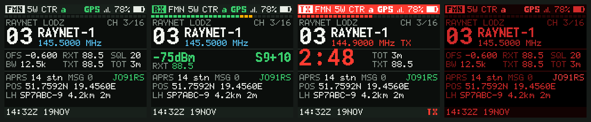
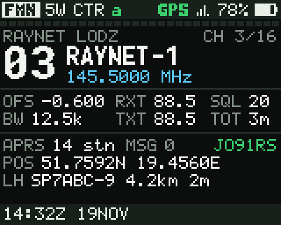
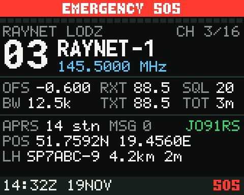
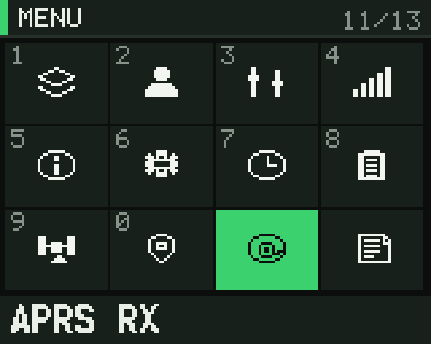

# SP7TEAM EMCOM firmware for the Retevis RT3S (OpenGD77 fork)

[](https://github.com/sptq/opengd77-rt3s-experiments/releases)


**Open firmware that turns an inexpensive Retevis RT3S into a field radio for
emergency communications (EMCOM):** a main screen modelled on professional
and military radios, APRS receive, messaging and SOS beacons, SSTV, DTMF and
CW decoders, fox and radiosonde hunting, GPS navigation. FM and DMR, built
on [OpenGD77](https://www.opengd77.com/).



## Highlights

| | |
|---|---|
|  | **EMCOM main screen.** Channel number first, fixed positions, state by colour *and* word (RX green, TX red, SCAN amber, SOS flashing), UTC clock, locator and GPS position, APRS stations and unread messages always in view. Red-only night mode. |
|  | **DMR and FM.** Caller callsign, talker alias, talkgroup; live RX level in dBm and S units on FM; TX timer with the TOT. |
|  | **SOS.** `SK1+9` twice: APRS position beacons with the emergency symbol, every minute then every two minutes, flashing banner. Same again to stop. |
|  | **Launcher menus.** Main menu, Options and Contacts are icon tiles with their key number: `1`…`9`, `0` open a tile at once, ▲▼ move, the full name is in the bottom bar. Option lists show the setting on the left and its value right aligned. |
|  | **One look across the whole radio.** Menus, lists, option boxes, notifications, soft key bars (GREEN / RED fields), APRS and SSTV screens and the SP7TEAM boot screen share the EMCOM style and colours; *Options → Display → Screen* switches everything back to classic. |
|  | **SSTV receive** (Robot, Martin, Scottie, PD — the ISS uses PD 120), picture drawn line by line. |

And more, all decoded by the radio itself from the FM audio:

* **APRS RX** — AFSK 1200 decoder, frames, raw TNC2/hex, stations with distance and
  bearing, radar, background RX; **APRS messages** with automatic ACK and replies.
* **DTMF and CW decoders** (CW: repeater IDs, speed and tone shown).
* **Band scope / waterfall**, fox hunting with GPS max-hold, radiosonde hunting
  (401–405 MHz presets, keypad waypoint), GPS waypoint page and trip computer.
* **EMCOM event log** — every TX, FM reception, DMR call, new APRS station, APRS
  message, DTMF sequence, SOS and SSTV picture with its UTC time, kept in flash
  across power cycles (2048 entries), on the radio and exported as CSV.
* **GPS track log to GPX**, **screenshots** over USB, quickkeys, Polish translation
  and a Polish how-to ([`PLANS/rt3s_instrukcja_pl.md`](PLANS/rt3s_instrukcja_pl.md)).

Screen pictures above are rendered from the firmware layout and fonts
(`docs/screens/render_screens.py`, example data); `tools/opengd77_screenshot.py`
takes real ones from a radio.

## Quick start

1. Download `OpenGD77_MDUV380_RT3S.bin` (or the 10 W / RT-84 variant) and
   `OpenGD77_Languages.zip` from the
   [latest release](https://github.com/sptq/opengd77-rt3s-experiments/releases).
2. Back up your codeplug. Put the radio in firmware-update mode: switched
   off, hold **PTT + the top side button** and switch it on.
3. Flash with the OpenGD77 loader. DMR needs the original Retevis / TYT
   firmware as the "donor" of the AMBE codec, as with any OpenGD77:
   ```sh
   python3 MDUV380_firmware/tools/opengd77_stm32_firmware_loader.py \
       -m MD-UV380 -f OpenGD77_MDUV380_RT3S.bin -L Polish.gla
   ```
4. Read the [fork features](#fork-features-rt3s--mduv380) below, or the Polish
   [how-to](PLANS/rt3s_instrukcja_pl.md).

**Experimental firmware — flash at your own risk.** Testers welcome: open an
issue with what works and what doesn't.

## About this fork

Maintainer: **Marcin SP7TQ**. This repository started as a fork of
[mangelajo/opengd77-rt3s-experiments](https://github.com/mangelajo/opengd77-rt3s-experiments)
by EA4IPW (OpenGD77 R20260131 source mirror, command-line build, VFO band
scope / waterfall, release tooling). From R20260131-EA4IPW.3 on it is
**developed independently**: new features land here first and are not
guaranteed to be merged back into that repository or into upstream
OpenGD77. It is **not affiliated with the OpenGD77 project**. History:
[`CHANGELOG.md`](CHANGELOG.md).

## What's here

| Path | Contents | Origin |
|---|---|---|
| `MDUV380_firmware/` | OpenGD77 R20260131 source release, verbatim | upstream |
| `MDUV380_firmware/Makefile` | Reconstructed from `.cproject` for command-line builds outside STM32CubeIDE | local addition |

The build wrapper scripts (Containerfile, `build.sh`) that drive a
[podman](https://podman.io/)-based Ubuntu container build live **outside this
repository** in the maintainer's working directory.

## License — **non-commercial only**

The OpenGD77 source code is distributed under a **modified BSD-3-Clause
license with an explicit non-commercial restriction** (see
[`license.txt`](license.txt) and
[`MDUV380_firmware/tools/license.txt`](MDUV380_firmware/tools/license.txt)).
Relevant clause:

> 4. Use of this source code or binary releases for commercial purposes is
> strictly forbidden. This includes, without limitation, incorporation in a
> commercial product or incorporation into a product or project which allows
> commercial use.

This restriction inherits to any fork or derivative work, including this one.

Bundled third-party components retain their own licenses:

- **CMSIS** — Apache-2.0
- **STM32F4xx HAL Driver** — BSD-3-Clause
- **ST USB Device Library** — ST SLA0044
- **FreeRTOS** — MIT (Amazon)
- **SEGGER RTT** — SEGGER custom BSD-like

See the `LICENSE`/`LICENSE.txt` files inside each subdirectory.

## Upstream and credits

- Upstream release zips: <https://www.opengd77.com/downloads/releases/>
- Community-maintained user guide:
  <https://github.com/LibreDMR/OpenGD77_UserGuide>
- Original authors and contributors are listed in
  the upstream README ([`UPSTREAM_README.md`](UPSTREAM_README.md))
  (Kai DG4KLU, Roger VK3KYY, Daniel F1RMB, Alex DL4LEX, Colin G4EML and
  many others).
- Fork maintainer: **Marcin SP7TQ** (RT3S features: APRS RX, GPS pages,
  VFO sweep improvements, fox and radiosonde hunting, quickkeys, Polish docs).
- Original fork and build tooling: EA4IPW, on which this
  repository is based.

If you are looking for the canonical firmware: **use
[opengd77.com](https://www.opengd77.com/)**, not this repo.

## Building

The firmware was historically built with STM32CubeIDE on Linux/Windows.
The added `Makefile` lets you build with a stock `arm-none-eabi-gcc` outside
the IDE.

```sh
# inside an Ubuntu / Debian environment with the ARM toolchain installed
cd MDUV380_firmware
make            # produces build/OpenGD77_MDUV380.bin
```

Other variants:

```sh
make build PLATFORM=MDUV380 VARIANT=UV380_PLUS_10W   # 10W mod
make build PLATFORM=RT84_DM1701 VARIANT=DM1701        # Retevis RT-84 / Baofeng DM-1701
make build-all                                        # all three; bins land in dist/
```

The build runs natively on macOS as well — `codec_cleaner` is now a portable
Python script (`MDUV380_firmware/tools/codec_cleaner.py`), so no podman
container is needed for this step.

> ⚠️ The build relies on the AMBE codec being patched in at **flash time**
> from a separate "donor" firmware. This repository contains zero AMBE
> code or data. See the OpenGD77 docs for the codec/flashing workflow.

## Cutting a release

Releases are tagged `R<upstream-date>-SP7TQ.<n>`, which anchors each binary
to the upstream OpenGD77 snapshot it was built from.

**Tag format:** `R<YYYYMMDD>-SP7TQ.<N>`
- `<YYYYMMDD>` — the date of the upstream OpenGD77 release the fork is based
  on (matches the upstream `R<date>` directories on opengd77.eu).
- `<N>` — incrementing build number against that upstream base, starting
  at `1`.

Older tags from before the fork went independent keep their
`R20260131-EA4IPW.<N>` names (the last one is `R20260131-EA4IPW.3`).

GitHub Actions do not run on this fork yet, so releases are built locally
with `make build-all CONTAINER_ENGINE=docker` (bins and `SHA256SUMS` in
`MDUV380_firmware/dist/`) and uploaded with `gh release create`. The CI
workflow accepts both tag schemes if Actions get enabled.

**How to cut a release:**

```sh
# on the commit you want to ship
git switch main
git pull sptq main

# tag, annotated, with a short note
git tag -a R20260131-SP7TQ.1 -m "Short release note"
git push sptq R20260131-SP7TQ.1
```

CI then:

1. Runs the full build matrix (MDUV380, MDUV380 +10W, RT84/DM-1701).
2. Downloads all `.bin` artifacts and generates a `SHA256SUMS` file.
3. Creates a public GitHub Release at the tag, with auto-generated
   release notes (commit list since the previous tag) and the bins
   attached.

To remove a bad release: delete the tag both locally and on the
remote (`git tag -d <tag>; git push origin :refs/tags/<tag>`) and
delete the corresponding Release in the GitHub UI.

## Fork features (RT3S / MDUV380)

The RT3S has PTT, SK1, SK2, the channel knob and the keypad. There is no
top/orange button. Firmware "ORANGE" events are emulated with **SK1 + GREEN**.

### EMCOM main screen — *default; Options → Display → Screen: EMCOM / Classic*

The channel and VFO screens use a layout modelled on professional and
military radios (`uiEmcom.c`). Everything has a fixed place and is left
aligned:

| Area | Content |
|---|---|
| Status bar | state field (mode when idle, `RX` green, `TX` red with the whole bar, `SCAN` amber), power, CTCSS/DCS or time slot, APRS beacon, GPS fix, volume, battery |
| S-meter | 32 segments, S9 and above in amber; mic level while transmitting |
| Channel | zone and `CH n/m`, channel number (16x32), name, frequency (`TX`, `REV`, `TA` marks); VFO: the frequency in 16x32 |
| Panel | FM: offset, RX/TX tone, squelch, bandwidth, TOT; DMR: TG/PC, CC, TS, contact. Receiving FM: level in dBm and S units. DMR call: callsign, TG, rest of the alias. Transmitting: timer in 16x32 |
| EMCOM rows | APRS stations heard, unread APRS messages, Maidenhead locator, position (GPS, else the fixed location), last heard (DMR station, or the last APRS station with distance) |
| Footer | UTC time and date, key / PTT lock, scan, SOS, `TX OFF` when TX inhibit is on |

The same style covers the whole UI: menu title bars (accent, capitals,
list position), full-width selection, square boxes without shadows, soft
key bars with a green (GREEN key) and a red (RED key) field, the APRS RX,
SSTV and event log screens, and the SP7TEAM boot screen (when no custom
boot image is set).

By day the screen is dark; at night (the existing day/night switch and
auto-night) it uses a red-only palette that keeps night vision. VFO sweep,
dual watch, frequency entry and the channel details view keep the classic
screen.

To give the menus the same colours: *Options → Theme → Day* (then *Night*),
`*` loads the EMCOM colours (dark by day, red at night), `GREEN` applies,
`SK2+GREEN` applies and saves.

**SOS:** `SK1+9` twice within 3 s (or the *SOS* quickkey action) starts APRS
position beacons with the emergency symbol and `EMERGENCY SOS` (3 at one
minute, then every two minutes) through the channel APRS configuration
(its QSY frequency when set), and a flashing banner; the same again stops it.

### Event log — *main menu → Event log*

The radio keeps a station log by itself: own transmissions (frequency,
duration), FM receptions of 2 s or more (frequency, duration, peak dBm),
DMR calls (callsign, TG), new APRS stations (with distance), APRS messages
in and out (and ACKs), DTMF sequences, SOS on / off and beacons, SSTV
pictures, and power-on. Each entry has its UTC time (GPS or CPS clock). The
log is a 64 KB ring in the SPI flash (2048 entries, the GPS NMEA log now
starts 64 KB later) and survives a power cycle.

On the radio: newest first, type field in colour, the selected entry in
full with its date in the footer; `0` then `GREEN` clears it. On a computer:
`MDUV380_firmware/tools/opengd77_event_log.py --csv log.csv`.

### Screenshots over USB

`MDUV380_firmware/tools/opengd77_screenshot.py -o screen.png` saves the radio
screen as a PNG (radio on, USB connected; `--count` / `--interval` for a
series, `--bgr` if red and blue are swapped).

### Quickkeys menu — *Options → Quickkeys*

Upstream already supports ten **SK2 + digit** quickkeys, but there is no screen
that shows what each slot does. This menu lists slots `0`–`9` with their
current assignment and lets you change them:

| Key | Action |
|---|---|
| ▲ / ▼ or a digit | select slot |
| channel knob | cycle the assignment |
| GREEN | save changed slots (marked `*`) and exit |
| RED | discard changes and exit |

On top of the menu shortcuts (RSSI, Last heard, Zones, Contacts, Radio info,
Satellite, GPS, APRS), a slot can run a fork **action**:

| Action | Equivalent built-in combo |
|---|---|
| APRS beacon | `SK1 + 2` |
| APRS on/off | `SK1 + 1` |
| Day/Night | `SK1 + RED` |
| Band scope | long `#` in VFO (also works from the Channel screen) |
| Scope: to peak | `SK1 + 0` while sweeping |

Actions are stored as out-of-range contact indices. Upstream firmware ignores
these, so going back to upstream with the same codeplug is harmless.

### VFO band scope / waterfall

Start it with long `#` in VFO mode. `*` toggles between waterfall and bars.

* **Peak hold**: a dot above each bar marks the recent maximum. It decays a
  little every sweep.
* **Strongest-signal marker**: a small triangle at the top of the scope marks
  the strongest carrier of the last sweep.
* **`SK1 + 0`**: re-centre the VFO on that carrier, rounded to the VFO step.
  The waterfall history slides along instead of being cleared.
* **`SK1 + 3`**: jump to the next band preset. The presets are 144.800 APRS,
  145.500 2 m, 401/403/405 MHz radiosondes, 433.925 LPD, 438.800 70 cm
  repeaters and 446.100 PMR446. Each
  press goes to the next preset above the current frequency and wraps around
  after the last one.

### Fox-hunt mode — *RSSI screen*

Press `#` on the RSSI screen to toggle it.

* A short beep every 0.6 s. Its pitch rises with the signal: 300 Hz at
  −130 dBm, 2.4 kHz at −40 dBm.
* **Max-hold**: the strongest reading so far is shown as `Max: … dBm` and as a
  marker on the S-meter.
* With a GPS fix, the position of that maximum is stored. The screen then shows
  the distance and bearing from where you are now (`Max @ 120m 045 deg`).
* `0` resets the max-hold.

### Waypoint page — *GPS menu, second-to-last page*

* Press **GREEN** to mark the current position (needs a GPS fix). The waypoint
  is kept in RAM until power-off.
* The page shows the distance and bearing back to the waypoint, plus an arrow:
  * when moving, the arrow is relative to your direction of travel (ahead = up);
  * when standing still, it is north-up.
* Within 5 m of the waypoint the arrow turns into a dot.
* **`#`** opens a keypad editor for the waypoint, for example to enter a
  radiosonde landing prediction from SondeHub:
  * coordinates are in decimal degrees;
  * `#` types the decimal point and `*` toggles the minus sign (S / W);
  * ▲ / ▼ switch between the lat and lon fields, RED deletes a character;
  * GREEN sets the waypoint.

### Radiosonde hunting

The radio cannot decode RS41 / M20 telemetry. Its only digital audio path to
the MCU runs at 8 kHz through a voice-band filter, while the sondes send
4800 / 9600 bd GFSK. You can still find a sonde:

1. Find the carrier: VFO → long `#` → `SK1 + 3` to the 401/403/405 MHz presets.
   Use `SK2 + ▲` to widen the span to 2 MHz.
2. Tune to it with `SK1 + 0`.
3. Enter the landing prediction as a waypoint: GPS → waypoint page → `#`.
4. Close in with fox-hunt mode on the RSSI screen.

### APRS receive — *main menu → APRS RX (or `9` on the RSSI screen); background: `SK1+4`*

A software AFSK 1200 demodulator runs on the FM RX audio the HR-C6000
sends over I2S (8 kHz): mark/space correlators, four slicers covering
de-/pre-emphasis tone twist, DPLL bit clock, NRZI, HDLC, AX.25 FCS check.
It only owns the I2S while nothing else needs it (beeps, voice prompts,
DMR audio and TX take over and the capture restarts by itself).

The APRS RX screen (main menu, quickkey, or `9` on the RSSI screen) has six
views, cycled with `#`:

* **frames** — last 8 frames; `*` shows the selected one raw (full TNC2
  line + hex dump),
* **stations** — last heard stations / objects with distance, bearing, age,
  speed and course,
* **radar** — north-up plot around your position, auto range; the GPS
  waypoint is drawn as a square, `*` makes the selected station the waypoint,
* **messages** — APRS messages to you (acknowledged automatically, about 2 s
  later), bulletins and your own messages with their state (`...` waiting,
  `ACK`, `REJ`, `FAIL`, `noTX`). `GREEN` replies to the selected message, or
  starts a message to the station selected in the stations / radar view,
  with a canned text (`QSL`, `73`, `Roger`...). Sent messages are retried
  every 30 s, 3 times at most. Your call is the radio name + the SSID of the
  channel APRS configuration, TX goes to its QSY frequency when set,
* **DTMF** — decoded DTMF digits (Goertzel, twist / energy checks),
* **CW** — Morse decoder for FM (repeater IDs), with WPM and tone.

Positions are decoded from uncompressed, compressed and Mic-E reports,
objects and items. Own position: GPS fix, else the location from the
settings. `SK1+4` on the VFO / channel screen (or the *APRS RX on/off*
quickkey action) keeps decoding in the background and pops a short
notification (`SP7ABC-9 12.3km`) per frame, DTMF sequences and APRS
messages; the setting survives a power cycle. The decoders and the parser
are hardware independent and have host tests
(`make -C MDUV380_firmware/tests/aprs_rx`).

### SSTV receive — *main menu → SSTV*

Picture receive on FM: Robot 36/72, Martin M1/M2, Scottie S1/S2,
PD 90/120/180 (the ISS uses PD 120 on 145.800). The mode comes from the VIS
header, every line is re-timed on its sync pulse, the picture is scaled to
160x120 and drawn as it arrives under a status line (mode, line, audio
frequency). `0` clears and waits for the next picture, `GREEN` / `RED`
leave; also available as a quickkey. While the screen is open APRS / DTMF /
CW decoding is paused (the SSTV decoder borrows their memory).

### Volume indicator

The header of the VFO / channel screens shows the volume knob position as
4 bars left of the GPS label (`x` when muted). The pop-up bar shown while
turning the knob is the upstream *Options → Display → Visual volume*
option.

### GPS log to GPX

With the GPS mode set to *On+Log* the firmware records NMEA into the last
2 MB of the SPI flash. `MDUV380_firmware/tools/opengd77_gps_log_to_gpx.py
-o track.gpx` downloads it over USB (pyserial) and writes one GPX track
segment per logging session.

### Trip computer — *GPS menu, last page*

The radio collects these in the background, whatever screen is shown. They
are kept in RAM only:

* distance travelled;
* moving time;
* average and maximum speed;
* altitude gain and loss.

Only movement above about 2 km/h is counted, so GPS jitter while you stand
still is ignored. Altitude changes under 5 m are ignored as noise. A
**long GREEN** press resets the trip.

Plans and the on-radio test checklist are in [`PLANS/`](PLANS/). A Polish how-to is in [`PLANS/rt3s_instrukcja_pl.md`](PLANS/rt3s_instrukcja_pl.md).

## Local experiments

Branches under `feature/*` may contain in-progress experiments (for
example, converting the existing VFO sweep mode in
`MDUV380_firmware/application/source/user_interface/uiVFOMode.c` into a
proper scrolling waterfall display). These are not endorsed by upstream
and may be broken at any commit.

— 73, Marcin SP7TQ
