# SP7TEAM EMCOM firmware for the Retevis RT3S (OpenGD77 fork)

[](https://github.com/sptq/opengd77-rt3s-experiments/releases)


**Open firmware that turns an inexpensive Retevis RT3S into a field radio for
emergency communications (EMCOM):** a main screen modelled on professional
and military radios, APRS receive, messaging and SOS beacons, SSTV, DTMF and
CW decoders, fox and radiosonde hunting, GPS navigation. FM and DMR, built
on [OpenGD77](https://www.opengd77.com/).


## Highlights

| | |
|---|---|
|  | **EMCOM main screen.** Channel number first, fixed positions, state by colour *and* word (RX green, TX red, SCAN amber, SOS flashing), UTC clock, locator and GPS position, APRS stations and unread messages always in view. Red-only night mode. |
| 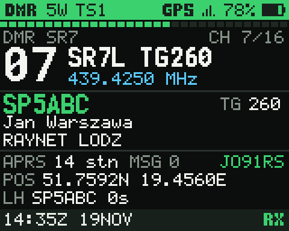 | **DMR and FM.** Caller callsign, talker alias, talkgroup and Last Heard age on DMR; live RX level in dBm and S units plus a stable repeater-distance row on FM; TX timer with the TOT. |
|  | **SOS.** `SK1+9` twice: APRS position beacons with the emergency symbol, every minute then every two minutes, flashing banner. Same again to stop. |
|  | **Launcher menus.** Main menu, Options and Contacts are icon tiles with their key number: `1`…`9`, `0` open a tile at once, ▲▼ move, the full name is in the bottom bar. Option lists show the setting on the left and its value right aligned. |
| 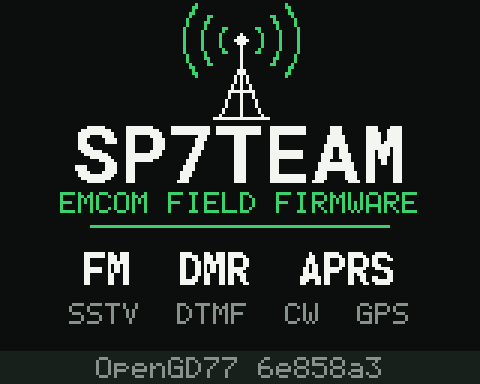 | **One look across the whole radio.** Menus, lists, option boxes, notifications, soft key bars (GREEN / RED fields), APRS and SSTV screens and the SP7TEAM boot screen share the EMCOM style and colours; *Options → Display → Screen* switches everything back to classic. |
| 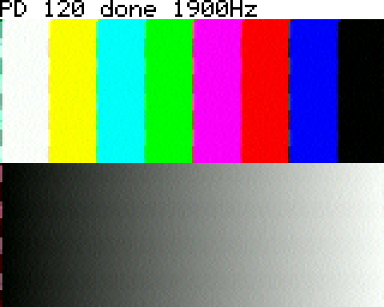 | **SSTV receive** (Robot, Martin, Scottie, PD — the ISS uses PD 120), picture drawn line by line. |

And more, all decoded by the radio itself from the FM audio:

* **APRS RX** — AFSK 1200 decoder, frames, raw TNC2/hex, stations with distance and
  bearing, radar, background RX; **APRS messages** with automatic ACK and replies.
* **DTMF and CW decoders** (CW: repeater IDs, speed and tone shown).
* **Band scope / waterfall**, fox hunting with GPS max-hold, radiosonde hunting
  (401–405 MHz presets, keypad waypoint), GPS waypoint page and trip computer.
* **EMCOM event log** — every TX, FM reception, DMR call, new APRS station, APRS
  message, DTMF sequence, SOS and SSTV picture with its UTC time, kept in flash
  across power cycles (2048 entries), on the radio and exported as CSV.
* **GPS track log to GPX**, **screenshots** over USB, quickkeys, Polish translation
  and a Polish how-to ([`PLANS/rt3s_instrukcja_pl.md`](PLANS/rt3s_instrukcja_pl.md)).

Screen pictures above are rendered from the firmware layout and fonts
(`docs/screens/render_screens.py`, example data); `tools/opengd77_screenshot.py`
takes real ones from a radio.

## Screens

All screens share one look: title bar with an accent and the position,
status strips with coloured fields, full-width selection, key bars at the
bottom, red-only palette at night. Pictures rendered from the firmware
layout, fonts and icons (`docs/screens/`, example data).

| | | |
|---|---|---|
| <br>Boot screen | <br>Main menu (keys 1–0 open a tile) | 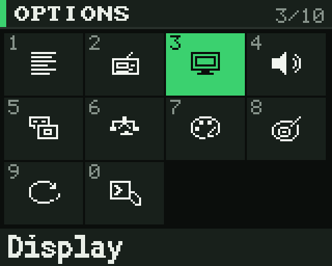<br>Options |
| 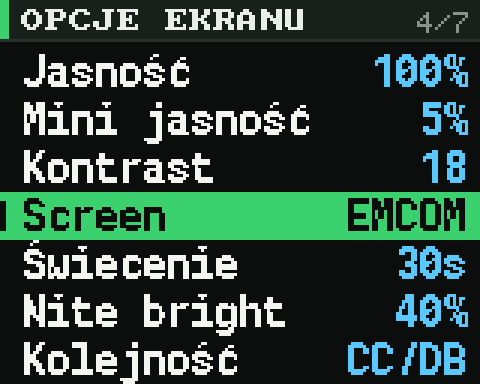<br>Option list, values right aligned | <br>Channel, standby | 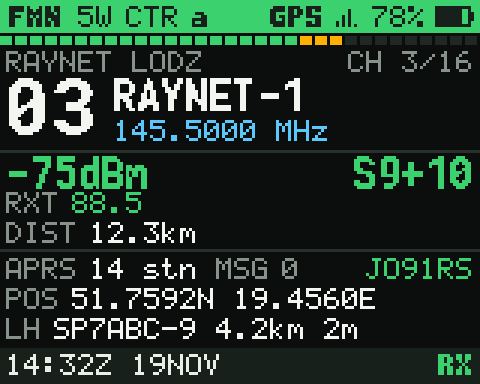<br>FM receive |
| 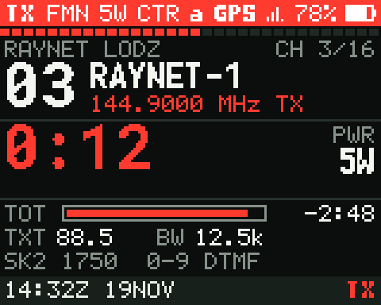<br>Transmit | <br>DMR call | 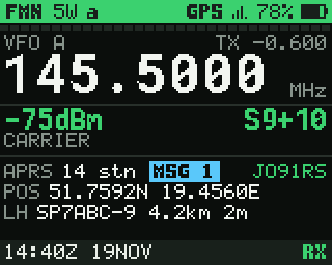<br>VFO |
| 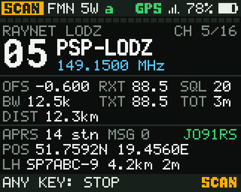<br>Scan | <br>SOS | 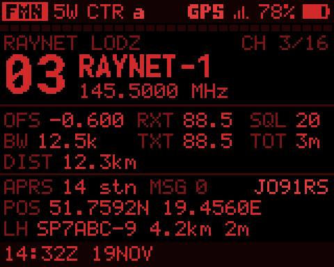<br>Night palette |
| 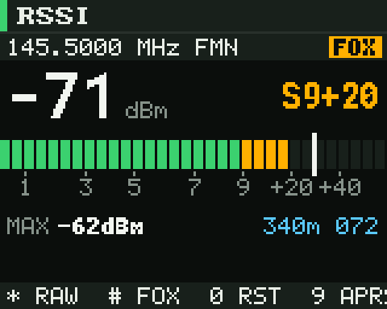<br>RSSI / fox hunt | 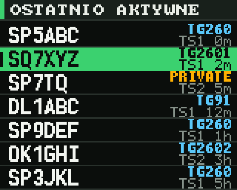<br>Last heard | 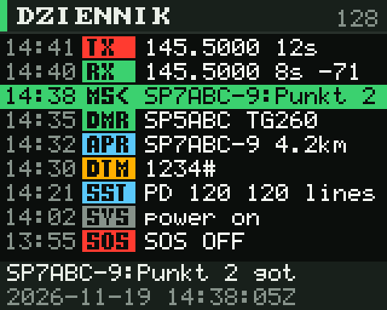<br>Event log |
| 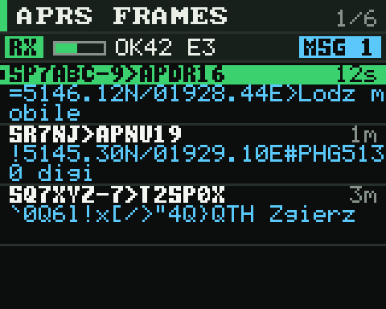<br>APRS frames | 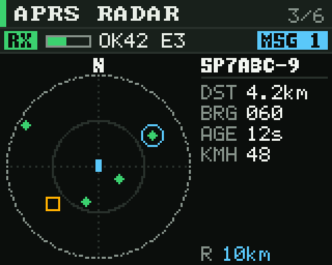<br>APRS radar | 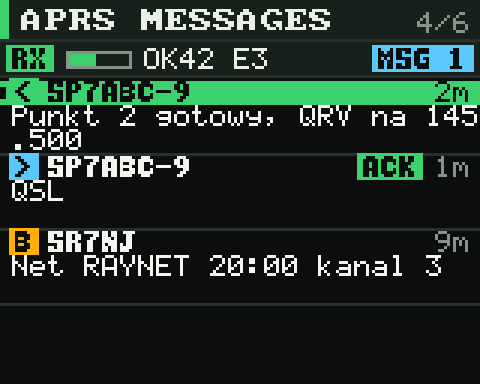<br>APRS messages |
| 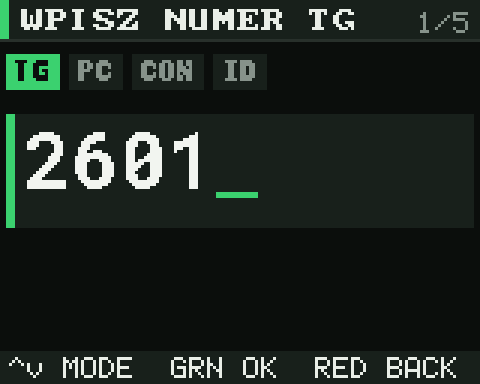<br>TG / PC entry | 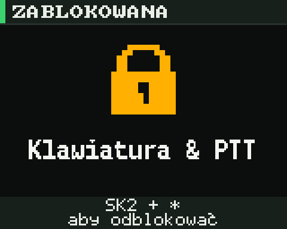<br>Keypad lock | <br>SSTV (PD 120) |
| 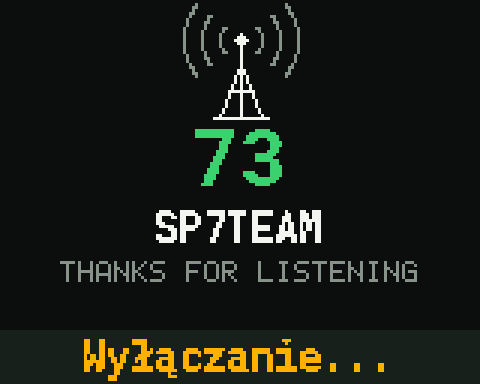<br>Power off | <br>Satellite passes, observer position | <br>Selected satellite, Doppler |
| <br>GPS status | <br>GPS signal per satellite | <br>GPS sky plot |

## Quick start

1. Download `OpenGD77_MDUV380_RT3S.bin` (or the 10 W / RT-84 variant) and
   `OpenGD77_Languages.zip` from the
   [latest release](https://github.com/sptq/opengd77-rt3s-experiments/releases).
2. Back up your codeplug. Put the radio in firmware-update mode: switched
   off, hold **PTT + the top side button** and switch it on.
3. Flash with the OpenGD77 loader. DMR needs the original Retevis / TYT
   firmware as the "donor" of the AMBE codec, as with any OpenGD77:
   ```sh
   python3 MDUV380_firmware/tools/opengd77_stm32_firmware_loader.py \
       -m MD-UV380 -f OpenGD77_MDUV380_RT3S.bin -L Polish.gla
   ```
4. Read the [fork features](#fork-features-rt3s--mduv380) below, or the Polish
   [how-to](PLANS/rt3s_instrukcja_pl.md).

**Experimental firmware — flash at your own risk.** Testers welcome: open an
issue with what works and what doesn't.

## About this fork

Maintainer: **Marcin SP7TQ**. This repository started as a fork of
[mangelajo/opengd77-rt3s-experiments](https://github.com/mangelajo/opengd77-rt3s-experiments)
by EA4IPW (OpenGD77 R20260131 source mirror, command-line build, VFO band
scope / waterfall, release tooling). From R20260131-EA4IPW.3 on it is
**developed independently**: new features land here first and are not
guaranteed to be merged back into that repository or into upstream
OpenGD77. It is **not affiliated with the OpenGD77 project**. History:
[`CHANGELOG.md`](CHANGELOG.md).

## What's here

| Path | Contents | Origin |
|---|---|---|
| `MDUV380_firmware/` | OpenGD77 R20260131 source release, verbatim | upstream |
| `MDUV380_firmware/Makefile` | Reconstructed from `.cproject` for command-line builds outside STM32CubeIDE | local addition |

The build wrapper scripts (Containerfile, `build.sh`) that drive a
[podman](https://podman.io/)-based Ubuntu container build live **outside this
repository** in the maintainer's working directory.

## License — **non-commercial only**

The OpenGD77 source code is distributed under a **modified BSD-3-Clause
license with an explicit non-commercial restriction** (see
[`license.txt`](license.txt) and
[`MDUV380_firmware/tools/license.txt`](MDUV380_firmware/tools/license.txt)).
Relevant clause:

> 4. Use of this source code or binary releases for commercial purposes is
> strictly forbidden. This includes, without limitation, incorporation in a
> commercial product or incorporation into a product or project which allows
> commercial use.

This restriction inherits to any fork or derivative work, including this one.

Bundled third-party components retain their own licenses:

- **CMSIS** — Apache-2.0
- **STM32F4xx HAL Driver** — BSD-3-Clause
- **ST USB Device Library** — ST SLA0044
- **FreeRTOS** — MIT (Amazon)
- **SEGGER RTT** — SEGGER custom BSD-like

See the `LICENSE`/`LICENSE.txt` files inside each subdirectory.

## Upstream and credits

- Upstream release zips: <https://www.opengd77.com/downloads/releases/>
- Community-maintained user guide:
  <https://github.com/LibreDMR/OpenGD77_UserGuide>
- Original authors and contributors are listed in
  the upstream README ([`UPSTREAM_README.md`](UPSTREAM_README.md))
  (Kai DG4KLU, Roger VK3KYY, Daniel F1RMB, Alex DL4LEX, Colin G4EML and
  many others).
- Fork maintainer: **Marcin SP7TQ** (RT3S features: APRS RX, GPS pages,
  VFO sweep improvements, fox and radiosonde hunting, quickkeys, Polish docs).
- Original fork and build tooling: EA4IPW, on which this
  repository is based.

If you are looking for the canonical firmware: **use
[opengd77.com](https://www.opengd77.com/)**, not this repo.

## Building

The firmware was historically built with STM32CubeIDE on Linux/Windows.
The added `Makefile` lets you build with a stock `arm-none-eabi-gcc` outside
the IDE.

```sh
# inside an Ubuntu / Debian environment with the ARM toolchain installed
cd MDUV380_firmware
make            # produces build/OpenGD77_MDUV380.bin
```

Other variants:

```sh
make build PLATFORM=MDUV380 VARIANT=UV380_PLUS_10W   # 10W mod
make build PLATFORM=RT84_DM1701 VARIANT=DM1701        # Retevis RT-84 / Baofeng DM-1701
make build-all                                        # all three; bins land in dist/
```

The build runs natively on macOS as well — `codec_cleaner` is now a portable
Python script (`MDUV380_firmware/tools/codec_cleaner.py`), so no podman
container is needed for this step.

> ⚠️ The build relies on the AMBE codec being patched in at **flash time**
> from a separate "donor" firmware. This repository contains zero AMBE
> code or data. See the OpenGD77 docs for the codec/flashing workflow.

## Cutting a release

Releases are tagged `R<upstream-date>-SP7TQ.<n>`, which anchors each binary
to the upstream OpenGD77 snapshot it was built from.

**Tag format:** `R<YYYYMMDD>-SP7TQ.<N>`
- `<YYYYMMDD>` — the date of the upstream OpenGD77 release the fork is based
  on (matches the upstream `R<date>` directories on opengd77.eu).
- `<N>` — incrementing build number against that upstream base, starting
  at `1`.

Older tags from before the fork went independent keep their
`R20260131-EA4IPW.<N>` names (the last one is `R20260131-EA4IPW.3`).

GitHub Actions do not run on this fork yet, so releases are built locally
with `make build-all CONTAINER_ENGINE=docker` (bins and `SHA256SUMS` in
`MDUV380_firmware/dist/`) and uploaded with `gh release create`. The CI
workflow accepts both tag schemes if Actions get enabled.

**How to cut a release:**

```sh
# on the commit you want to ship
git switch main
git pull sptq main

# tag, annotated, with a short note
git tag -a R20260131-SP7TQ.1 -m "Short release note"
git push sptq R20260131-SP7TQ.1
```

CI then:

1. Runs the full build matrix (MDUV380, MDUV380 +10W, RT84/DM-1701).
2. Downloads all `.bin` artifacts and generates a `SHA256SUMS` file.
3. Creates a public GitHub Release at the tag, with auto-generated
   release notes (commit list since the previous tag) and the bins
   attached.

To remove a bad release: delete the tag both locally and on the
remote (`git tag -d <tag>; git push origin :refs/tags/<tag>`) and
delete the corresponding Release in the GitHub UI.

## Fork features (RT3S / MDUV380)

The RT3S has PTT, SK1, SK2, the channel knob and the keypad. There is no
top/orange button. Firmware "ORANGE" events are emulated with **SK1 + GREEN**.

### EMCOM main screen — *default; Options → Display → Screen: Classic / EMCOM / EMCOM mono / EMCOM contr*

The channel and VFO screens use a layout modelled on professional and
military radios (`uiEmcom.c`). Everything has a fixed place and is left
aligned:

| Area | Content |
|---|---|
| Status bar | mode / TX / SCAN field, power, CTCSS/DCS or time slot, APRS beacon, GPS fix, volume, battery; RX is shown in the footer |
| S-meter | 32 segments, S9 and above in amber; mic level while transmitting |
| Channel | zone and `CH n/m`, channel number (16x32), name, frequency (`TX`, `REV`, `TA` marks); VFO: the frequency in 16x32 |
| Panel | FM: offset, RX/TX tone, squelch, bandwidth, TOT; DMR: TG/PC, CC, TS, contact. Receiving FM: level in dBm and S units plus a stable reserved repeater-distance row. Channel scan uses the parameter panel and the same distance row. DMR call: callsign, TG and two-line caller ID. Transmitting: elapsed time in 16x32 and the power level |
| EMCOM rows | APRS stations heard, unread APRS messages, Maidenhead locator, position (GPS, else the fixed location), last heard (DMR station, or the last APRS station with distance) |
| EMCOM rows (TX) | time-out timer bar with the remaining time (the last 10 s hatched, the countdown in an inverse chip), TX tone / bandwidth or TG / CC / TS and contact, the keys usable while transmitting |
| Footer | UTC time and date, `RX` / `TX` / `SCAN`, key / PTT lock, SOS, `TX OFF` when TX inhibit is on |

The existing *Options → Display* header settings also apply to the EMCOM status
bar: **Time in header** replaces the battery readout (unless a low-battery
warning or forced battery display is active), and **Battery** selects percentage
or voltage. **Visual volume** controls the EMCOM header volume indicator and the
volume notification. The footer clock remains available in either case. When **UTC** is
set to **No**, the footer shows local time first and Zulu time second using
the trailing `Z` marker on the Zulu time; with **UTC = Yes**, it shows Zulu
time only.

The **Show dist** setting in *Options → Display* controls whether the repeater
distance is calculated on channel-mode standby, during FM channel reception,
and on the channel-scan parameter screen.
The `DIST` row remains reserved in those layouts and is blank when the setting
is off. With distance enabled, it shows `DIST --` when either location is
unavailable or invalid. It is not shown during FM VFO reception or DMR
reception; DMR reception keeps the extra middle row for the second line of
caller information. The operator position is taken from a valid GPS fix first,
with the configured location used as the fallback.

The same style covers the whole UI: menu title bars (accent, capitals,
list position), full-width selection, square boxes without shadows, soft
key bars with a green (GREEN key) and a red (RED key) field, the APRS RX,
SSTV and event log screens, message boxes and notifications (a card with
the kind as a word and a glyph shape: info disc, warning triangle, error
square, question diamond), and the SP7TEAM boot screen (when no custom
boot image is set).

By day the screen is dark; at night (the existing day/night switch and
auto-night) it uses a red-only palette that keeps night vision. VFO sweep,
dual watch and frequency-entry special modes keep the classic screen; channel
details remains in the EMCOM layout with its compact two-row detail panel.

To give the menus the same colours: *Options → Theme → Day* (then *Night*),
`*` loads the EMCOM colours (dark by day, red at night), `GREEN` applies,
`SK2+GREEN` applies and saves.

#### Accessibility styles: EMCOM mono and EMCOM contr *(untested)*

Two more values of *Options → Display → Screen* (`◄` / `►` step through
Classic, EMCOM, EMCOM mono, EMCOM contr). Both are the EMCOM layout on every
screen (main, menus, APRS, SSTV, GPS, satellites, field tools) with another
palette, and both follow the day / night switch.

* **EMCOM mono**, for colour-blind users: white and grey shades on black
  (night: the red shades of the night palette). No state is shown by hue
  alone: idle is an outlined mode chip, `SCAN` is a solid chip, `RX` is shown
  in the green footer, and `TX` turns the whole status bar to inverse video (black text) with a black `TX`
  chip; S-meter segments above S9 are hollow (main and RSSI screens); a low
  battery shows `!` and the percentage in an inverse chip; no GPS fix draws
  `GPS` thin and grey; `SOS`, `TX OFF` and `TX` in the footer are inverse
  chips. Menus: grey preset, the selected row a white block. The band scope
  waterfall uses a brightness ramp.
* **EMCOM contr**, for low vision: white and yellow on black (night: amber and
  red-orange), all small text in the bold font, the channel frequency in 8x16
  under the name, a thicker S-meter, the selected row a solid yellow block,
  and the same shape cues as mono.

A theme saved in *Options → Theme* still wins in the menus. Contrast ratios
(WCAG, text on its background): mono day 7.5–21, contrast day 19.6–21,
contrast night 6.0–10.3, mono night as the EMCOM night palette (1.9–6.3, kept
dim for night vision); `python3 docs/screens/palette_check.py` prints all of
them, also with a protanopia / deuteranopia simulation.

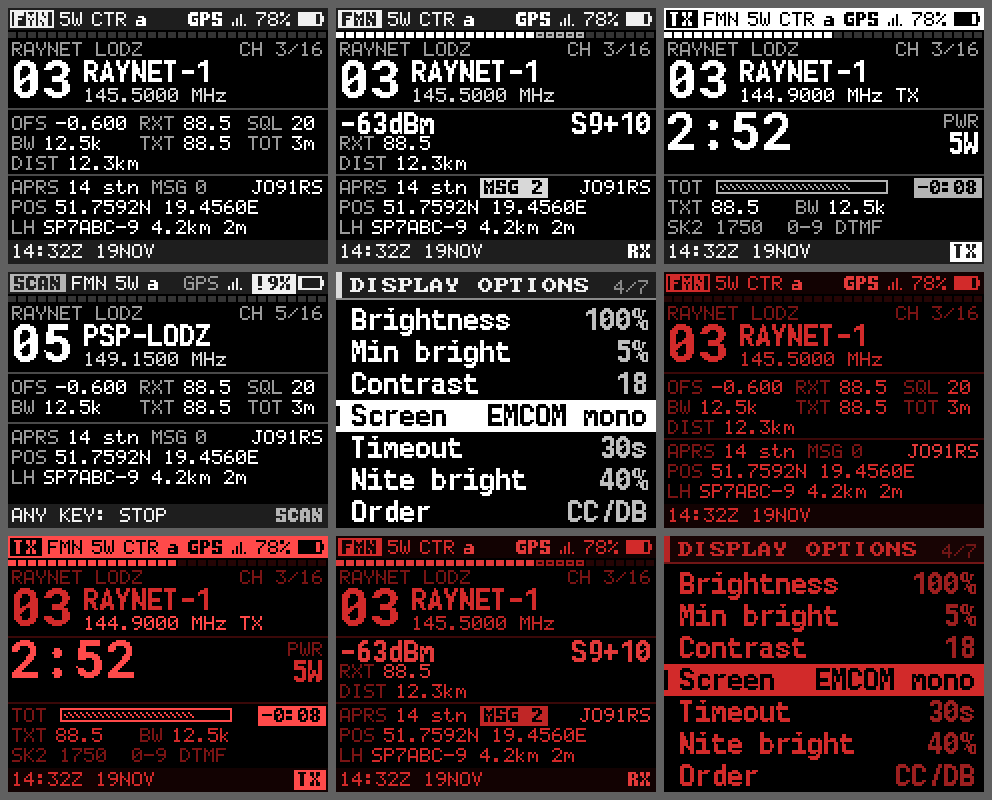

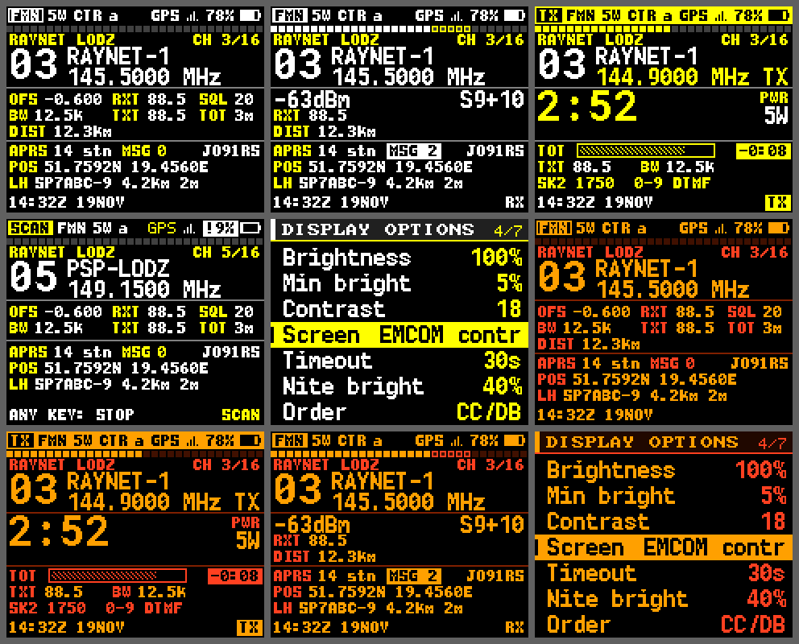

**SOS:** `SK1+9` twice within 3 s (or the *SOS* quickkey action) starts APRS
position beacons with the emergency symbol and `EMERGENCY SOS` (3 at one
minute, then every two minutes) through the channel APRS configuration
(its QSY frequency when set), and a flashing banner; the same again stops it.
The beacons also go out while the Position, PACE, Coverage, Radio check,
Net control, Waypoints, Sked, GPS, APRS RX, Event log, Last heard or lock screen is open. On the TX,
satellite and SSTV screens, in menus and while editing they wait
(`SOS PAUSED` shows once) and go out as soon as you are back.

**Blackout / silent mode:** `SK1+5` on the channel / VFO screen (or the
*Blackout* quickkey action) for night or covert work, `BLACKOUT ON` / `OFF`
card. The backlight stays off until a key is pressed and then lights at 5 % for
the normal timeout; no key beeps, alert or RX / TX beeps, no voice prompts, RX /
TX LEDs off. TX (1750 Hz and DTMF included), receive audio, SOS beacons and the
on-screen alerts are unchanged (sked cards too, without the beep). Voice prompts
are not queued meanwhile, so nothing stale plays afterwards. The EMCOM footer shows a solid `BLK` chip. Not
kept over a power cycle: the radio always boots with your own backlight settings.

**Battery time left:** an estimate such as `~3h20` from the voltage trend of the
last 30 minutes (transmissions left out), on the right of the EMCOM footer when
nothing else is shown there and under the voltage on *Radio infos → Battery*.
`--` for the first 15 minutes, while charging and just after the charger is
plugged in or removed. Not on the classic main screen (no room in the header).


### Event log — *main menu → Event log*

The radio keeps a station log by itself: own transmissions (frequency,
duration), FM receptions of 2 s or more (frequency, duration, peak dBm),
DMR calls (callsign, TG), new APRS stations (with distance), APRS messages
in and out (and ACKs), DTMF sequences, SOS on / off and beacons, SSTV
pictures, and power-on. Each entry has its UTC time (GPS or CPS clock). The
log is a 64 KB ring in the SPI flash (2048 entries, the GPS NMEA log now
starts 64 KB later) and survives a power cycle.

On the radio: newest first, type field in colour, the selected entry in
full with its date in the footer; `0` then `GREEN` clears it (any other key
cancels). On a computer:
`MDUV380_firmware/tools/opengd77_event_log.py --csv log.csv`.

### Field tools — *main menu → PACE / Position / Coverage / Radio check / Net control*

Five screens for working in the field, also available as quickkeys, plus the
saved waypoints and the comms schedule (sked). The PACE, sked, waypoint,
Coverage and Radio check data lives in the last 64 KB of the SPI flash and
survives a power cycle.

| 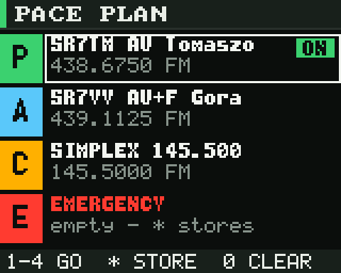 | 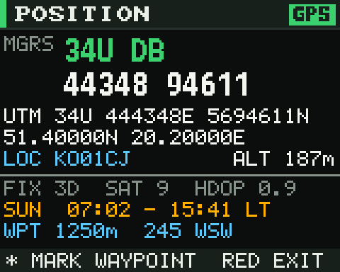 |
|---|---|
| 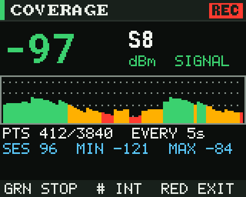 | 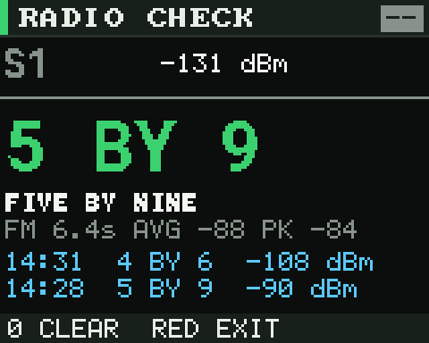 |

* **PACE plan**: Primary / Alternate / Contingency / Emergency channels.
  `1`–`4` (or `GREEN` on the selected slot) switch the radio to that
  channel, `*` stores the current channel in the selected slot (channel
  mode only), `0` then `GREEN` clears the slot, `#` opens the sked list.
  With a sked set, the strip (classic: the key bar) counts down to the next one.
* **Sked (comms schedule)** *(untested)*: up to 4 skeds — *PACE → `#`* or the
  *Sked* quickkey action. Each: every 15 / 20 / 30 min, 1–12 h or daily, from
  a UTC time (e.g. `HOURLY :00`, `EVERY 30M :15`, `DAILY 18:00`), 1–60 min long,
  optionally with a PACE slot or the current channel. List: `GREEN` edits
  (`▲` / `▼` field, `◄` / `►` value, `GREEN` save, `RED` cancel), `0` then
  `GREEN` deletes; rows show `ON` / `OFF` / `NOW` and the count-down. One
  minute before a sked: a `SKED in 1 min` card and a beep; at the start: a
  `SKED n NOW` card with the channel, a beep and `SYS SKED n` in the event log.
  On the channel / VFO screen `GREEN` on that card tunes to the sked channel;
  the radio never changes channel by itself. Needs the UTC clock (GPS / CPS);
  no beeps in a blackout.
* **Position**: own position in MGRS (large) and UTM, decimal degrees,
  locator, altitude, GPS fix / satellites / HDOP, sunrise and sunset, and
  distance and bearing to the waypoint; `*` marks the current position as
  the waypoint.
* **Coverage survey**: records the signal level with the GPS position every
  1–30 s (`#` changes the interval, `GREEN` starts / stops), up to 3840
  points, with a live graph and the session min / max. `0` then `GREEN`
  clears the memory. On a computer:
  `MDUV380_firmware/tools/opengd77_coverage.py` makes a coloured KML map,
  GPX or CSV.
* **Radio check**: every received over is measured (length, average and
  peak level) and rated readability / strength ("5 by 9"), with the last
  reports below. `0` then `GREEN` clears the reports.
* **Net control** *(untested)*: runs an EMCOM net. `GREEN` starts it
  (logged `NET START <channel>`); from then on every station heard on DMR
  (last heard list: callsign, else the DMR ID) or APRS checks in by itself
  (`NET IN <station>`). Each row: station, check-in time (UTC), time since
  last heard and `IN` (solid chip) or `QUIET` (outlined chip: not heard for
  the quiet limit, which also logs `NET QUIET <station>` once, beeps and
  shows a warning card, re-armed when the station is heard again). FM
  speakers cannot be identified: `*` adds `FM#1`, `FM#2`... at the current
  time, `GREEN` on an `FM#` row marks it heard now. `GREEN` on another row
  logs a QSO with report 59 (`QSO <station> 59`). `#` steps the quiet limit
  10 / 15 / 30 / 5 min (RAM, back to 10 after power off), `0` then `GREEN`
  ends the net (`NET END <n>`), `RED` leaves with the net still running.
  The roster holds 18 stations (RAM, not kept after power off); the event log
  keeps the whole history.


|  |  |
|---|---|


In **Last heard**, `*` logs a QSO with the selected station (report 59) and
shows *QSO logged*. QSOs and net events are event log entries of type `QSO`
and `NET` (`opengd77_event_log.py` exports them).

Every clear asks first: the key bar shows the question, `GREEN` confirms
and any other key cancels (you stay on the screen). The same goes for the
Event log (`0`) and Last heard (long `#`).

### Screenshots over USB

`MDUV380_firmware/tools/opengd77_screenshot.py -o screen.png` saves the radio
screen as a PNG (radio on, USB connected; `--count` / `--interval` for a
series, `--bgr` if red and blue are swapped).

### Quickkeys menu — *Options → Quickkeys*

Upstream already supports ten **SK2 + digit** quickkeys, but there is no screen
that shows what each slot does. This menu lists slots `0`–`9` with their
current assignment and lets you change them:

| Key | Action |
|---|---|
| ▲ / ▼ or a digit | select slot |
| channel knob | cycle the assignment |
| GREEN | save changed slots (marked `*`) and exit |
| RED | discard changes and exit |

On top of the menu shortcuts (RSSI, Last heard, Zones, Contacts, Radio info,
Satellite, GPS, APRS), a slot can run a fork **action**:

| Action | Equivalent built-in combo |
|---|---|
| APRS beacon | `SK1 + 2` |
| APRS on/off | `SK1 + 1` |
| Day/Night | `SK1 + RED` |
| Band scope | long `#` in VFO (also works from the Channel screen) |
| Scope: to peak | `SK1 + 0` while sweeping |
| Blackout | `SK1 + 5` |
| Waypoints | GPS waypoint page `*` |
| Sked | PACE `#` |

Actions are stored as out-of-range contact indices. Upstream firmware ignores
these, so going back to upstream with the same codeplug is harmless.

### VFO band scope / waterfall

Start it with long `#` in VFO mode. `*` toggles between waterfall and bars.

* **Peak hold**: a dot above each bar marks the recent maximum. It decays a
  little every sweep.
* **Strongest-signal marker**: a small triangle at the top of the scope marks
  the strongest carrier of the last sweep.
* **`SK1 + 0`**: re-centre the VFO on that carrier, rounded to the VFO step.
  The waterfall history slides along instead of being cleared.
* **`SK1 + 3`**: jump to the next band preset. The presets are 144.800 APRS,
  145.500 2 m, 401/403/405 MHz radiosondes, 433.925 LPD, 438.800 70 cm
  repeaters and 446.100 PMR446. Each
  press goes to the next preset above the current frequency and wraps around
  after the last one.

### Fox-hunt mode — *RSSI screen*

Press `#` on the RSSI screen to toggle it.

* A short beep every 0.6 s. Its pitch rises with the signal: 300 Hz at
  −130 dBm, 2.4 kHz at −40 dBm.
* **Max-hold**: the strongest reading so far is shown as `Max: … dBm` and as a
  marker on the S-meter.
* With a GPS fix, the position of that maximum is stored. The screen then shows
  the distance and bearing from where you are now (`Max @ 120m 045 deg`).
* `0` resets the max-hold.

### GPS screen — *main menu → GPS*

Six pages in the EMCOM style (`▲▼` page, number in the title bar): status,
signal, sky plot, position / course, waypoint, trip. The classic style keeps
its five pages as they were (no status page).

|  |  |  |
|---|---|---|

The receiver does not tell which satellites it uses for the fix, so the pages
tell satellites **with a signal** (SNR above 0) from satellites only **in
view**: `GPS 8/10` in the strip = 8 heard of 10 in view.

* **Status (1/6)**: fix state as a big field (`3D FIX` green, `2D FIX` amber,
  `NO FIX` red), the GPS UTC time, or while there is no fix the **search
  time** since the GPS was turned on or lost its fix (measures the time to
  first fix). Latitude / longitude (5 decimals, from the GPS), Maidenhead
  locator, altitude, HDOP with a word (`GOOD` up to 2, `FAIR` up to 5, else
  `POOR`), speed, course (when moving), `TTFF` of the last search, GPS date,
  `NMEA>USB` in the NMEA mode. GPS off: says so, `SK2`+`GREEN` turns it on
  (`SK2`+`RED` turns it off, on any page).
* **Signal (2/6)**: one bar per satellite, strongest first, SNR in dB-Hz
  (dotted lines every 10, denser at 30), the PRN number under each bar
  (two staggered rows when many). **GPS bars are solid, BeiDou bars hatched**
  (also blue / red; the shapes keep them apart in the red night palette and
  for colour-blind users); a satellite in view without a signal is a low
  hollow box with a grey number. Up to 24 bars, `+N` for the rest. Before
  the first satellites: *No satellites yet* with the search time.
* **Sky plot (3/6)**: north up, horizon and 30° / 60° rings (labelled where
  free), **GPS = discs, BeiDou = squares, filled with a signal, hollow
  without**; PRN numbers beside the satellites with a signal where they do
  not collide (strongest first). Right column: fix state, HDOP, legend.
* Pages 4–6: position / course, waypoint, trip computer (classic drawing).

### Waypoint page — *GPS menu, second-to-last page*

* Press **GREEN** to mark the current position (needs a GPS fix). The waypoint
  is kept in RAM until power-off.
* The page shows the distance and bearing back to the waypoint, plus an arrow:
  * when moving, the arrow is relative to your direction of travel (ahead = up);
  * when standing still, it is north-up.
* Within 5 m of the waypoint the arrow turns into a dot.
* **`#`** opens a keypad editor for the waypoint, for example to enter a
  radiosonde landing prediction from SondeHub:
  * coordinates are in decimal degrees;
  * `#` types the decimal point and `*` toggles the minus sign (S / W);
  * ▲ / ▼ switch between the lat and lon fields, RED deletes a character;
  * GREEN sets the waypoint.
* **`*`** opens the **saved waypoints** *(untested)* (also the *Waypoints*
  quickkey action): 8 named positions kept in the flash, each row with its
  distance, compass point and a north-up arrow from the GPS fix (`--` without
  a fix, `>` on the current target):
  * GREEN navigates: sets the waypoint and shows this page;
  * `*` saves the current position (`WP1`..`WP8`), `#` types lat / lon (same
    keypad entry as above) into a free slot;
  * ► renames (A-Z, 0-9, `-`), `0` then GREEN deletes;
  * on the APRS RX stations / radar view, long `*` sets a station as the
    waypoint and saves it under its callsign;
  * `MDUV380_firmware/tools/opengd77_coverage.py --waypoints wpts.gpx` exports
    them to a GPX file.

### Radiosonde hunting

The radio cannot decode RS41 / M20 telemetry. Its only digital audio path to
the MCU runs at 8 kHz through a voice-band filter, while the sondes send
4800 / 9600 bd GFSK. You can still find a sonde:

1. Find the carrier: VFO → long `#` → `SK1 + 3` to the 401/403/405 MHz presets.
   Use `SK2 + ▲` to widen the span to 2 MHz.
2. Tune to it with `SK1 + 0`.
3. Enter the landing prediction as a waypoint: GPS → waypoint page → `#`.
4. Close in with fox-hunt mode on the RSSI screen.

### APRS receive — *main menu → APRS RX (or `9` on the RSSI screen); background: `SK1+4`*

A software AFSK 1200 demodulator runs on the FM RX audio the HR-C6000
sends over I2S (8 kHz): mark/space correlators, four slicers covering
de-/pre-emphasis tone twist, DPLL bit clock, NRZI, HDLC, AX.25 FCS check.
It only owns the I2S while nothing else needs it (beeps, voice prompts,
DMR audio and TX take over and the capture restarts by itself).

The APRS RX screen (main menu, quickkey, or `9` on the RSSI screen) has six
views, cycled with `#`:

* **frames** — last 8 frames; `*` shows the selected one raw (full TNC2
  line + hex dump),
* **stations** — last heard stations / objects with distance, bearing, age,
  speed and course,
* **radar** — north-up plot around your position, auto range; the GPS
  waypoint is drawn as a square, `*` makes the selected station the waypoint,
* **messages** — APRS messages to you (acknowledged automatically, about 2 s
  later), bulletins and your own messages with their state (`...` waiting,
  `ACK`, `REJ`, `FAIL`, `noTX`). `GREEN` replies to the selected message, or
  starts a message to the station selected in the stations / radar view,
  with a canned text (`QSL`, `73`, `Roger`...). Sent messages are retried
  every 30 s, 3 times at most. Your call is the radio name + the SSID of the
  channel APRS configuration, TX goes to its QSY frequency when set,
* **DTMF** — decoded DTMF digits (Goertzel, twist / energy checks),
* **CW** — Morse decoder for FM (repeater IDs), with WPM and tone.

Positions are decoded from uncompressed, compressed and Mic-E reports,
objects and items. Own position: GPS fix, else the location from the
settings. `SK1+4` on the VFO / channel screen (or the *APRS RX on/off*
quickkey action) keeps decoding in the background and pops a short
notification (`SP7ABC-9 12.3km`) per frame, DTMF sequences and APRS
messages; the setting survives a power cycle. The decoders and the parser
are hardware independent and have host tests
(`make -C MDUV380_firmware/tests/aprs_rx`).

### Satellites — *main menu → Satellite*

Pass predictions from the TLEs in the codeplug (CPS), Doppler corrected RX /
TX. In the EMCOM style the four views share the fork look (title with the
view number, status strip, key bar):

|  |  |
|---|---|

* **List (1/4)**: the strip shows **where the observer position comes
  from** — `GPS` (GPS on with a fix; the fix is written to the location
  setting) or `MANUAL` (typed in) — and the short lat / lon. Rows: name, AOS
  time (`NOW` while in view), maximum elevation. `▲▼` scroll, `GREEN` opens
  the top row (`SK2`+`GREEN`: wake-up alarm before AOS), **`*` edits the
  position**: Radio infos → Location opens, type `DD.DDDD DDD.DDDD`
  (13 digits; while typing `▲`/`▼` = N/S, with `SK2` E/W), `GREEN` saves,
  `SK2`+`GREEN` turns the GPS on, `RED` comes back to the list and the
  passes are predicted again for the new position. The Location page shows
  these keys in its key bar.
* **Selected satellite (2/4)**: AZ / EL, Doppler corrected RX / TX,
  power, countdown `AOS in` / `LOS in` and maximum elevation. `1` / `2` /
  `3` pick the voice / APRS / other frequency, `9` opens SSTV with the
  Doppler retune running, `#` jumps to the next satellite in view.
* **Sky plot (3/4)** and **pass details (4/4)** (`▲▼` switch views, `◄►`
  step through the passes, `RED` back to the list).

### SSTV receive — *main menu → SSTV*

Picture receive on FM: Robot 36/72, Martin M1/M2, Scottie S1/S2,
PD 90/120/180 (the ISS uses PD 120 on 145.800). The mode comes from the VIS
header, every line is re-timed on its sync pulse, the picture is scaled to
160x120 and drawn as it arrives under a status line (mode, line, audio
frequency). `0` clears and waits for the next picture, `GREEN` / `RED`
leave; also available as a quickkey. While the screen is open APRS / DTMF /
CW decoding is paused (the SSTV decoder borrows their memory), and so are
APRS beacons and message replies.

* **Frequency**: `UP` / `DOWN` step through the channel / VFO the screen was
  opened on, ISS 145.800 and 437.800 (FM, wide, no CTCSS). The presets are
  RX only (PTT just beeps); leaving the screen goes back to the channel.
* **Doppler**: on the satellite screen select a satellite and press `9`.
  SSTV opens on that satellite's frequency and keeps the Doppler retune
  running once a second (TLE, clock and position needed, as for the
  satellite screen). On 2 m FM it matters little (±3.5 kHz); on 70 cm
  (±10 kHz) it keeps the signal in the filter.
* **Saved pictures**: every picture of 30 lines or more is saved to the SPI
  flash with its UTC time, mode and frequency; the 8 newest are kept
  (320 KB taken from the end of the GPS NMEA log). Download them as PNG on
  [sp7tq.pl/rt3s/narzedzia](https://sp7tq.pl/rt3s/narzedzia/#sstv) (SSTV tab)
  or with `tools/opengd77_sstv.py -d pictures/`.

### Volume indicator

The header of the VFO / channel screens shows the volume knob position as
4 bars left of the GPS label (`x` when muted). The pop-up bar shown while
turning the knob is the upstream *Options → Display → Visual volume*
option.

### GPS log to GPX

With the GPS mode set to *On+Log* the firmware records NMEA into the last
2 MB of the SPI flash. `MDUV380_firmware/tools/opengd77_gps_log_to_gpx.py
-o track.gpx` downloads it over USB (pyserial) and writes one GPX track
segment per logging session.

### Trip computer — *GPS menu, last page*

The radio collects these in the background, whatever screen is shown. They
are kept in RAM only:

* distance travelled;
* moving time;
* average and maximum speed;
* altitude gain and loss.

Only movement above about 2 km/h is counted, so GPS jitter while you stand
still is ignored. Altitude changes under 5 m are ignored as noise. A
**long GREEN** press resets the trip.

Plans and the on-radio test checklist are in [`PLANS/`](PLANS/). A Polish how-to is in [`PLANS/rt3s_instrukcja_pl.md`](PLANS/rt3s_instrukcja_pl.md).

## Local experiments

Branches under `feature/*` may contain in-progress experiments (for
example, converting the existing VFO sweep mode in
`MDUV380_firmware/application/source/user_interface/uiVFOMode.c` into a
proper scrolling waterfall display). These are not endorsed by upstream
and may be broken at any commit.

— 73, Marcin SP7TQ
